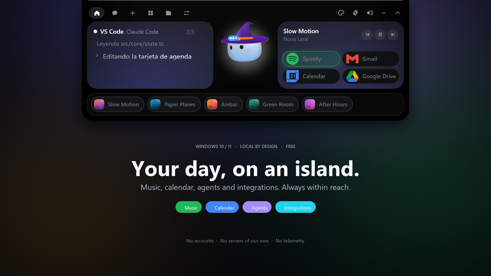

<div align="center">

[Español](README.md) · [English](README.en.md)


# Coso

### The island Windows was missing.

Your music, calendar, reminders, inbox and coding agents, in an island that lives at the top edge of your screen.

**Free. Local by design. No accounts.**

<br />

<a href="https://github.com/marlonayaladev/coso/releases/latest">
  
</a>
<a href="#screenshots">
  
</a>

<br /><br />


<br />

<a href="https://github.com/marlonayaladev/coso/releases/latest">
  
</a>

</div>

---

## Fewer windows. More context.

Coso is not another window to open. It is a layer at the top edge of your desktop that shows what is happening right now: what is playing, what is next, what is pending and what your agents are doing.

It opens with one click, gets out of the way on its own and **never steals focus**. The right information, in the right place: up top and out of the way.

> **Coso does not ask you to create an account.** No sign-up, no web dashboard and no Coso servers. If you connect Google, Spotify or WhatsApp, you talk to those services directly.

### Everything that matters, at a glance

- 🎵 **Music, without switching apps.** Spotify as a pill, with controls, an equalizer and a queue with cover art, title and artist. Any SMTC-compatible player shows up in the mini player.
- 📅 **Your calendar, with a countdown.** Google Calendar, upcoming events, a 10-minute alert and event creation with OpenCode models.
- ⏰ **Reminders that stick.** Shortcuts for 30 minutes, today or tomorrow; a persistent alert and a **Gym** mode that blocks the screen until you are done.
- ✉️ **Mail and files, right here.** Gmail inbox, compose and send from the island. Drag a file onto Drive and get its share link.
- 🤖 **Your agents, live.** **Claude Code** sessions with the step being executed and **Allow / Deny** approvals. Chat with Claude or OpenCode's free models.
- 🎨 **A companion with personality.** 18 outfits plus a seasonal automatic mode, themes, a desktop Coso and global shortcuts.
- 🔒 **Private by design.** Keys in the **Windows Credential Manager**, offline voice transcription with Vosk and zero telemetry.

## Screenshots

<sub>Real app screenshots with demo data. The UI is shown in Spanish.</sub>

### Everything, at a glance

The island brings together what is happening now: the Claude Code session and its progress, what is playing and your services. When something changes, you see it without opening a window.

<p align="center">
  
</p>

### Your day, without switching windows

Google Calendar, a live countdown and your next events. With OpenCode models, chat can also create events for you: “create a meeting tomorrow from 10 to 11” and it shows up in your calendar.

<p align="center">
  
</p>

### Ask, dictate, get things done

Talk to Claude or to OpenCode's free models. Drop a file onto the island to ask about its contents, or use the microphone: dictation is transcribed **on your PC**, with no audio sent anywhere.

<p align="center">
  
</p>

### Music that keeps the beat

Spotify, cover art, controls and the real queue. Tap a row and it plays. If you prefer YouTube Music or VLC, the mini player shows what is playing through SMTC. Mochi dances along.

<p align="center">
  
</p>

### Focus, not just a timer

Pomodoro and Animedoro with breaks, cycles and a strict mode. During focus, Coso turns into a tomato and the screen is blocked until you are done. “It's urgent” pauses it; reminders wait.

<p align="center">
  
</p>

### Make it yours

Midnight, Sakura, Ocean, Forest, Sunset, Graphite or White. Or pick your own color. Change the theme, the outfit, the monitor Coso lives on and even its shortcuts.

<p align="center">
  
</p>

### Your tools, under control

Choose up to four pills to sit next to Coso. Connect Google from its cards, keep keys in the Credential Manager and decide which services you want within reach.

<p align="center">
  
</p>

## What it does

| Area | What it does |
|---|---|
| **Music** | Spotify with controls and queue; any SMTC-compatible player in the mini player. |
| **Day to day** | Google Calendar, reminders, 10-minute alerts and Gym mode. |
| **Communication** | Gmail for reading, composing and sending; WhatsApp through the local bridge. |
| **Files** | Drag and drop, Google Drive uploads, full or partial screenshots, and PDF ↔ Word, images to PDF and MP4 to MP3 conversion. |
| **Agents** | Claude Code in the island with approvals; chat with Claude or OpenCode, even about a file. |
| **Desktop** | Always on top without stealing focus, desktop mode, multiple monitors and configurable auto-close. |
| **Customization** | 18 outfits + Auto, 7 palettes + custom color, 9 global shortcuts and pinned apps. |
| **Privacy** | No Coso account, no telemetry and keys in the Windows Credential Manager. |

## Install

Download the latest installer from **[Releases](https://github.com/marlonayaladev/coso/releases/latest)**. It installs per user: **no administrator rights required**.

1. Run the `.exe` installer.
2. If Windows shows **“Windows protected your PC”**, click **More info** and then **Run anyway**. This is expected: the app does not have a paid code-signing certificate yet.
3. Open Coso and move the cursor to the **top center edge** of the screen. The island peeks out.

> **Can't see it?** Check the system tray. From there you can open Coso, pause it or go to Settings.

## Build from source

Requirements:

- **Rust** stable ([rustup.rs](https://rustup.rs))
- **Node.js 20+**
- **Visual Studio Build Tools** with the **Desktop development with C++** workload

```powershell
git clone https://github.com/marlonayaladev/coso.git
cd coso/windows
npm install
npm run dev     # island in development mode
npm run pack    # installer in windows/release/
```

Run the frontend tests with `npm test`.

## Configure

Click the Coso tray icon → **Settings…**

| What | How |
|---|---|
| **Claude Code** | Local hooks show sessions and let you approve permissions from the island. If Coso is not running, the hook exits immediately and your agent never gets stuck. |
| **Chat** | Pick Claude or a free OpenCode model. The Anthropic key is stored in the Credential Manager, never on disk. |
| **Google** | Connect Calendar, Gmail or Drive from each service card. Coso only requests the scopes it uses. |
| **Spotify** | Detected automatically through SMTC. The queue is optional: to read it, Coso restarts Spotify with its debug port when you pause it. |
| **WhatsApp** | Coso downloads and starts the local bridge; link your phone from the card. |
| **Integrations** | Choose up to 4 pills. Keys live in the Windows Credential Manager. |

### Supported agents

| Agent | Connection |
|---|---|
| **Claude Code** | Through its local hooks; Coso backs up your `settings.json` before touching it. |
| **OpenCode** | The engine behind the free chat models; downloaded automatically on first use. |
| **Other agents** | Pass `--agent <name>` to the hook. |

## How it works

- A **[Tauri 2](https://tauri.app)** app (Rust + TypeScript). The island is a transparent, always-on-top window that **never steals focus**; Mochi is drawn on **Canvas 2D**.
- Agent hooks go through a small executable and a *named pipe*. Keys live in the **Windows Credential Manager**.
- Music comes from the system (**SMTC**), so it works with Spotify, VLC or a browser. The Spotify queue is read from the client over **CDP**, without the Spotify API.
- Voice is transcribed locally with **Vosk**: no audio leaves your PC.
- Coso has no servers of its own. It only talks to the services you configure.

## Shortcuts

<details>
<summary><strong>Show the 9 global shortcuts</strong></summary>

<br />

| Action | Shortcut |
|---|---|
| Open chat | `Ctrl+Alt+Space` |
| Go to the alert | `Ctrl+Alt+A` |
| Next task | `Ctrl+Alt+]` |
| Previous task | `Ctrl+Alt+[` |
| Mute or unmute sound | `Ctrl+Alt+M` |
| Coso on the desktop | `Ctrl+Alt+D` |
| Open the wardrobe | `Ctrl+Alt+G` |
| Start or pause Pomodoro | `Ctrl+Alt+P` |
| Show or hide the island | `Ctrl+Shift+N` |

All of them can be changed in **Settings › Keyboard shortcuts**. Coso detects conflicts with other apps.

</details>

## Releases

Windows releases are published as `v*` tags. Full notes in [Releases](https://github.com/marlonayaladev/coso/releases).

| Version | Date | Highlights |
|---|---|---|
| [0.1.18](https://github.com/marlonayaladev/coso/releases/tag/v0.1.18) | Oct 14, 2026 | `latest.json` without a BOM so the updater can read it |
| [0.1.17](https://github.com/marlonayaladev/coso/releases/tag/v0.1.17) | Oct 14, 2026 | Gmail card with compose and send |
| [0.1.16](https://github.com/marlonayaladev/coso/releases/tag/v0.1.16) | Oct 13, 2026 | Automatic OpenCode download with retries |
| [0.1.13](https://github.com/marlonayaladev/coso/releases/tag/v0.1.13) | Oct 9, 2026 | Google Drive, official icons and self-installing OpenCode |
| [0.1.12](https://github.com/marlonayaladev/coso/releases/tag/v0.1.12) | Oct 8, 2026 | Events from chat, “Your order” screen and a quieter island |
| [0.1.11](https://github.com/marlonayaladev/coso/releases/tag/v0.1.11) | Oct 7, 2026 | Spotify queue with cover art, player and equalizer |
| [0.1.10](https://github.com/marlonayaladev/coso/releases/tag/v0.1.10) | Oct 6, 2026 | Faithful attachments, turns up to 300 s and a real upload bar |
| [0.1.9](https://github.com/marlonayaladev/coso/releases/tag/v0.1.9) | Oct 5, 2026 | One-click file upload and isolated OpenCode |

## FAQ

**Is it free?**

Yes. The app is free. The source is published for transparency, but it is **not open source**: all rights are reserved.

**Do I need a Coso account?**

No. For Google, Gmail or Drive you use your own Google account through OAuth. Coso does not create accounts or store your passwords.

**Does it work offline?**

The island, reminders, music playing on your machine and dictation work offline. Chat, Google, WhatsApp and updates need internet.

**Where are my keys?**

In the **Windows Credential Manager**. They are never written to `settings.json` or sent to Coso servers.

**Why does Windows warn me during install?**

Because the installer is not signed with a paid code-signing certificate yet. Click **More info → Run anyway**.

**Can I use another agent?**

Yes. Besides Claude Code and OpenCode, the hook accepts `--agent <name>` to identify other sessions.

## Credits

Made by **Codificado**.

## License

**All rights reserved.** Any copying is subject to criminal prosecution.

<div align="center">

**⭐ If Coso helps you organize your day, leave it a star.**

[Website](https://marlonayaladev.github.io/coso-site/) · [Privacy](https://marlonayaladev.github.io/coso-site/privacidad.html) · [Terms](https://marlonayaladev.github.io/coso-site/condiciones.html) · [Releases](https://github.com/marlonayaladev/coso/releases)

</div>
