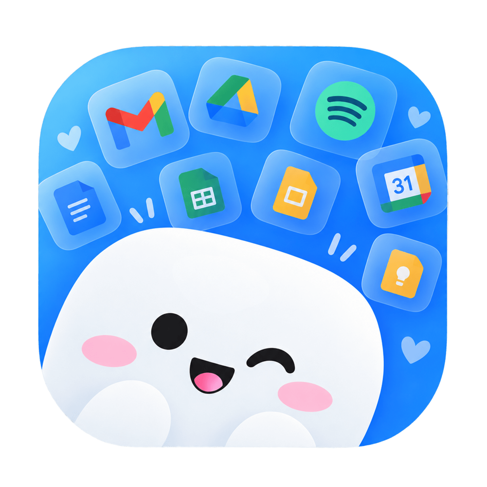
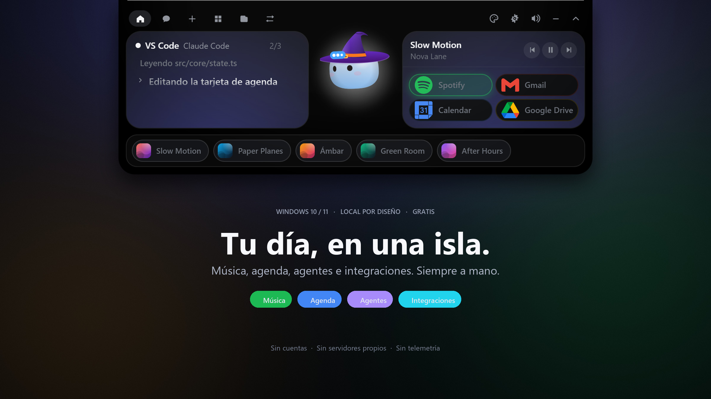
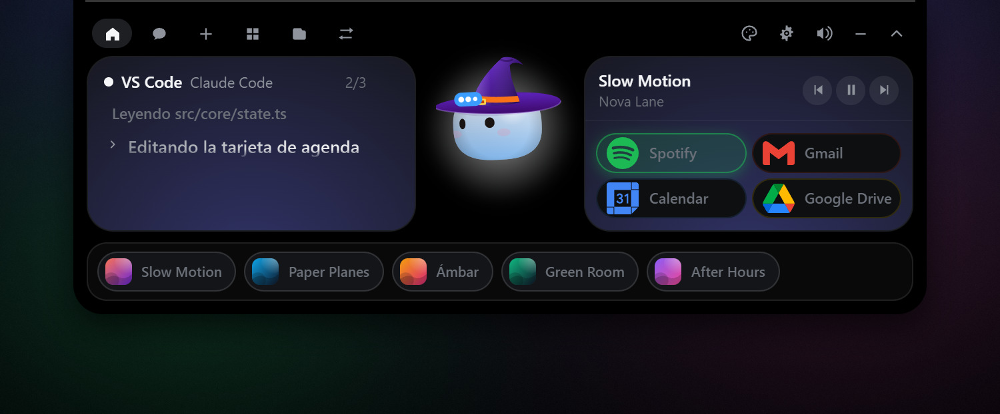
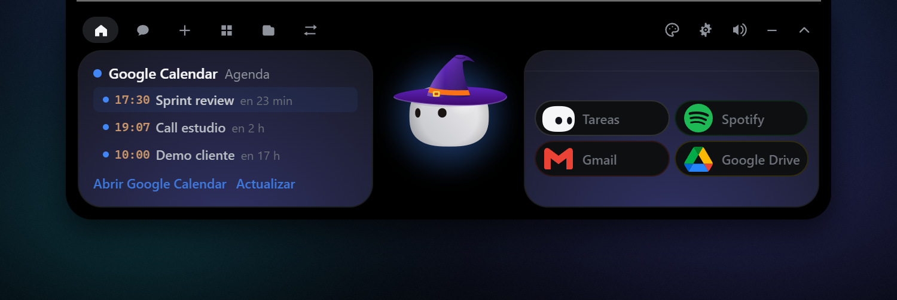
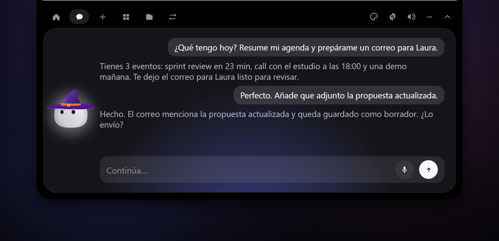
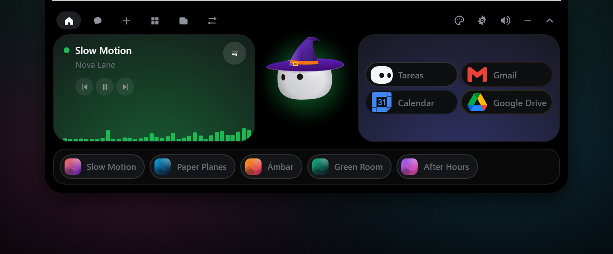
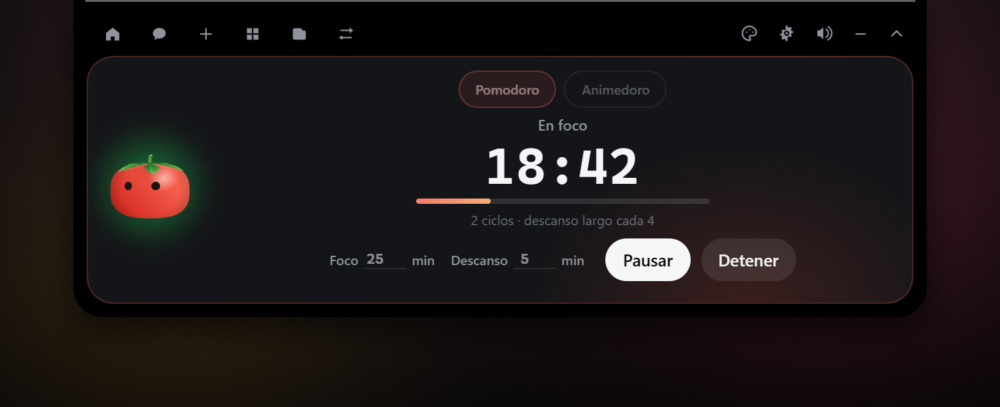
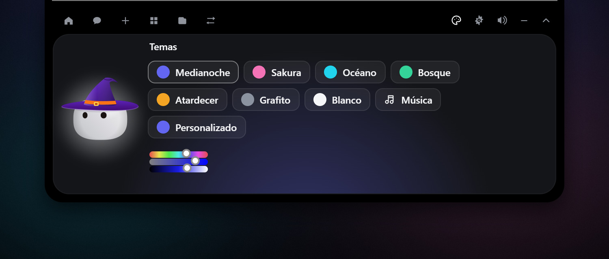
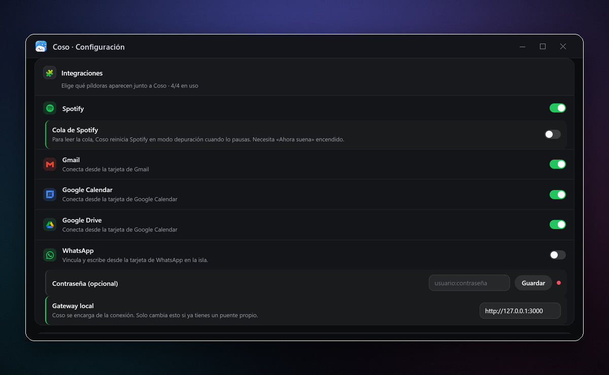

<div align="center">

[Español](README.md) · [English](README.en.md)



# Coso

### La isla que le faltaba a Windows.

Música, agenda, recordatorios, correo y agentes de código en una isla que vive en el borde superior de tu pantalla.

**Gratis. Local por diseño. Sin cuentas.**

<br />

<a href="https://github.com/marlonayaladev/coso/releases/latest">
  
</a>
<a href="#capturas">
  
</a>

<br /><br />


<br />

<a href="https://github.com/marlonayaladev/coso/releases/latest">
  
</a>

</div>

---

## Menos ventanas. Más contexto.

Coso no es otra ventana que abrir. Es una capa que vive en el borde superior del escritorio y te enseña justo lo que está pasando: lo que suena, lo que viene, lo que te falta y en qué están tus agentes.

Se abre con un clic, se aparta solo y **nunca roba el foco**. La información correcta, en el sitio correcto: arriba y fuera del camino.

> **Coso no te pide una cuenta.** No hay registro, no hay panel web y no hay servidores de Coso. Si conectas Google, Spotify o WhatsApp, hablas directamente con esos servicios.

### Todo lo importante, a un vistazo

- 🎵 **Música, sin cambiar de app.** Spotify como píldora, controles, ecualizador y cola con portada, título y artista. Cualquier reproductor que hable SMTC aparece en el mini reproductor.
- 📅 **Tu agenda, con cuenta atrás.** Google Calendar, próximos eventos, aviso 10 minutos antes y creación de eventos con los modelos de OpenCode.
- ⏰ **Recordatorios que se cumplen.** Atajos para 30 minutos, hoy o mañana; alerta persistente y modo **Gimnasio** que bloquea la pantalla hasta que termines.
- ✉️ **Correo y archivos, sin salir.** Bandeja de Gmail, redacción y envío desde la isla. Arrastra un archivo a Drive y obtén su enlace para compartir.
- 🤖 **Tus agentes, en vivo.** Sesiones de **Claude Code** con el paso que están ejecutando y aprobaciones de permiso desde la isla. Chat con Claude o con los modelos gratis de **OpenCode**.
- 🎨 **Un compañero con carácter.** 18 disfraces más el modo automático por estación, temas, Coso suelto por el escritorio y atajos globales.
- 🔒 **Privado por diseño.** Claves en el **Administrador de credenciales de Windows**, dictado offline con Vosk y cero telemetría.

## Capturas

<sub>Capturas reales de la app con datos de demostración.</sub>

### Todo, de un vistazo

La isla reúne lo que está pasando ahora: la sesión de Claude Code con su progreso, lo que suena y tus servicios. Si algo cambia, lo ves sin abrir una ventana.

<p align="center">
  
</p>

### Tu día, sin cambiar de ventana

Google Calendar, cuenta atrás en vivo y tus próximos eventos. Con los modelos de OpenCode, el chat también crea eventos por ti: «crea una reunión mañana de 10 a 11» y aparece en tu calendario.

<p align="center">
  
</p>

### Pregunta, dicta, resuelve

Habla con Claude o con los modelos gratuitos de OpenCode. Suelta un archivo sobre la isla para preguntar por su contenido, o usa el micrófono: el dictado se transcribe **en tu PC**, sin enviar audio a ninguna parte.

<p align="center">
  
</p>

### Música que sigue el ritmo

Spotify, portada, controles y cola real. Toca una fila y suena. Si prefieres YouTube Music o VLC, el mini reproductor muestra lo que esté sonando mediante SMTC. Mochi baila al compás.

<p align="center">
  
</p>

### Enfoque, no solo un temporizador

Pomodoro y Animedoro con descansos, ciclos y modo estricto. Durante el foco, Coso se convierte en tomate y la pantalla se bloquea hasta que termines. «Es urgente» lo pausa; los recordatorios esperan.

<p align="center">
  
</p>

### Hecho a tu manera

Medianoche, Sakura, Océano, Bosque, Atardecer, Grafito o Blanco. O elige tu propio color. Cambia el tema, el disfraz, la pantalla donde vive Coso y hasta sus atajos.

<p align="center">
  
</p>

### Tus herramientas, bajo control

Elige hasta cuatro píldoras para acompañar a Coso. Conecta Google desde sus tarjetas, guarda las claves en el Administrador de credenciales y decide qué servicios quieres tener a mano.

<p align="center">
  
</p>

## Lo que hace

| Área | Lo que hace |
|---|---|
| **Música** | Spotify con controles y cola; cualquier reproductor compatible con SMTC en el mini reproductor. |
| **Día a día** | Google Calendar, recordatorios, alertas de 10 minutos y modo Gimnasio. |
| **Comunicación** | Gmail para leer, redactar y enviar; WhatsApp mediante el puente local. |
| **Archivos** | Arrastrar y soltar, subida a Google Drive, capturas de pantalla completas o parciales y conversión PDF ↔ Word, imágenes a PDF y MP4 a MP3. |
| **Agentes** | Claude Code en la isla con aprobaciones; chat con Claude u OpenCode, incluso sobre un archivo. |
| **Escritorio** | Coso siempre encima, sin robar el foco, con modo escritorio, múltiples monitores y auto-cierre configurable. |
| **Personalización** | 18 disfraces + Auto, 7 paletas + color propio, 9 atajos globales y aplicaciones fijadas. |
| **Privacidad** | Sin cuentas de Coso, sin telemetría y claves en el Administrador de credenciales de Windows. |

## Instalar

Descarga el instalador más reciente desde **[Releases](https://github.com/marlonayaladev/coso/releases/latest)**. Es una instalación por usuario: **no necesitas permisos de administrador**.

1. Abre el instalador `.exe`.
2. Si Windows muestra **«Windows protegió tu PC»**, pulsa **Más información** y luego **Ejecutar de todos modos**. Es normal: la app aún no tiene certificado de firma digital.
3. Abre Coso y pasa el cursor por el **borde superior central** de la pantalla. La isla asoma sola.

> **¿No la ves?** Comprueba que Coso esté en la bandeja del sistema. Desde ahí puedes abrirlo, pausarlo o ir a Ajustes.

## Compilar desde el código

Requisitos:

- **Rust** estable ([rustup.rs](https://rustup.rs))
- **Node.js 20+**
- **Visual Studio Build Tools** con la carga de trabajo **Desarrollo para escritorio con C++**

```powershell
git clone https://github.com/marlonayaladev/coso.git
cd coso/windows
npm install
npm run dev     # isla en modo desarrollo
npm run pack    # instalador en windows/release/
```

Los tests del frontend se ejecutan con `npm test`.

## Configurar

Clic en el icono de Coso en la bandeja del sistema → **Ajustes…**

| Qué | Cómo |
|---|---|
| **Claude Code** | Hooks locales para ver sesiones y aprobar permisos desde la isla. Si Coso no está abierto, el hook termina de inmediato y tu agente nunca se bloquea. |
| **Chat** | Elige Claude o un modelo gratuito de OpenCode. La clave de Anthropic se guarda en el Administrador de credenciales, nunca en el disco. |
| **Google** | Conecta Calendar, Gmail o Drive desde la tarjeta de cada servicio. Coso solo pide los permisos que usa. |
| **Spotify** | Se detecta automáticamente por SMTC. La cola es opcional: para leerla, Coso reinicia Spotify en modo depuración cuando lo pausas. |
| **WhatsApp** | Coso descarga y arranca el puente local; vincula el teléfono desde la tarjeta. |
| **Integraciones** | Elige hasta 4 píldoras. Las claves viven en el Administrador de credenciales de Windows. |

### Agentes soportados

| Agente | Cómo se conecta |
|---|---|
| **Claude Code** | Mediante sus hooks locales; Coso respalda tu `settings.json` antes de tocar nada. |
| **OpenCode** | Motor de los modelos gratuitos del chat; se descarga solo la primera vez. |
| **Otros agentes** | Usa el flag `--agent <nombre>` en el hook. |

## Cómo funciona

- Una app **[Tauri 2](https://tauri.app)** (Rust + TypeScript). La isla es una ventana transparente, siempre encima, que **nunca roba el foco**; Mochi se dibuja en **Canvas 2D**.
- Los hooks de los agentes pasan por un pequeño ejecutable y una *named pipe*. Las claves viven en el **Administrador de credenciales de Windows**.
- La música se lee del sistema (**SMTC**), así que funciona con Spotify, VLC o el navegador. La cola de Spotify se lee del cliente por **CDP**, sin la API de Spotify.
- La voz se transcribe en local con **Vosk**: ningún audio sale de tu PC.
- Coso no tiene servidores propios. Solo se conecta a los servicios que tú configures.

## Atajos

<details>
<summary><strong>Ver los 9 atajos globales</strong></summary>

<br />

| Acción | Atajo |
|---|---|
| Abrir el chat | `Ctrl+Alt+Space` |
| Ir al aviso | `Ctrl+Alt+A` |
| Siguiente tarea | `Ctrl+Alt+]` |
| Tarea anterior | `Ctrl+Alt+[` |
| Activar o silenciar el sonido | `Ctrl+Alt+M` |
| Coso en el escritorio | `Ctrl+Alt+D` |
| Abrir el guardarropa | `Ctrl+Alt+G` |
| Iniciar o pausar el Pomodoro | `Ctrl+Alt+P` |
| Mostrar u ocultar la isla | `Ctrl+Shift+N` |

Todos se pueden cambiar desde **Ajustes › Atajos de teclado**. Coso detecta conflictos con otros programas.

</details>

## Versiones

Las versiones de Windows se publican como tags `v*`. Notas completas en [Releases](https://github.com/marlonayaladev/coso/releases).

| Versión | Fecha | Novedades |
|---|---|---|
| [0.1.18](https://github.com/marlonayaladev/coso/releases/tag/v0.1.18) | 14 oct 2026 | `latest.json` sin BOM para que el actualizador lo lea |
| [0.1.17](https://github.com/marlonayaladev/coso/releases/tag/v0.1.17) | 14 oct 2026 | Tarjeta de Gmail con redacción y envío |
| [0.1.16](https://github.com/marlonayaladev/coso/releases/tag/v0.1.16) | 13 oct 2026 | Descarga automática de OpenCode con reintentos |
| [0.1.13](https://github.com/marlonayaladev/coso/releases/tag/v0.1.13) | 9 oct 2026 | Google Drive, iconos oficiales y OpenCode autoinstalable |
| [0.1.12](https://github.com/marlonayaladev/coso/releases/tag/v0.1.12) | 8 oct 2026 | Eventos desde el chat, pantalla «Tu pedido» e isla más silenciosa |
| [0.1.11](https://github.com/marlonayaladev/coso/releases/tag/v0.1.11) | 7 oct 2026 | Cola de Spotify con portada, reproductor y ecualizador |
| [0.1.10](https://github.com/marlonayaladev/coso/releases/tag/v0.1.10) | 6 oct 2026 | Adjuntos fieles, turnos de hasta 300 s y barra de subida real |
| [0.1.9](https://github.com/marlonayaladev/coso/releases/tag/v0.1.9) | 5 oct 2026 | Subida de archivos con un clic y OpenCode aislado |

## Preguntas frecuentes

**¿Es gratis?**

Sí. La app es gratuita. El código se publica para transparencia, pero **no es open source**: todos los derechos están reservados.

**¿Necesito una cuenta de Coso?**

No. Para Google, Gmail o Drive usas tu propia cuenta de Google mediante OAuth. Coso no crea cuentas ni guarda tus contraseñas: las claves de los servicios que conectes viven en el Administrador de credenciales.

**¿Funciona sin internet?**

La isla, los recordatorios, la música que reproduces en tu equipo y el dictado funcionan sin conexión. El chat, Google, WhatsApp y las actualizaciones necesitan internet.

**¿Dónde están mis claves?**

En el **Administrador de credenciales de Windows**. Nunca se escriben en `settings.json` ni se envían a servidores de Coso.

**¿Por qué Windows me avisa al instalar?**

Porque el instalador todavía no está firmado con un certificado de firma de pago. Pulsa **Más información → Ejecutar de todos modos**.

**¿Puedo usar otro agente?**

Sí. Además de Claude Code y OpenCode, el hook acepta `--agent <nombre>` para identificar otras sesiones.

## Créditos

Hecho por **Codificado**.

## Licencia

**Todos los derechos reservados.** Cualquier copia bajo observación penal.

<div align="center">

**⭐ Si Coso te ordena el día, déjale una estrella.**

[Web](https://marlonayaladev.github.io/coso-site/) · [Privacidad](https://marlonayaladev.github.io/coso-site/privacidad.html) · [Condiciones](https://marlonayaladev.github.io/coso-site/condiciones.html) · [Releases](https://github.com/marlonayaladev/coso/releases)

</div>
